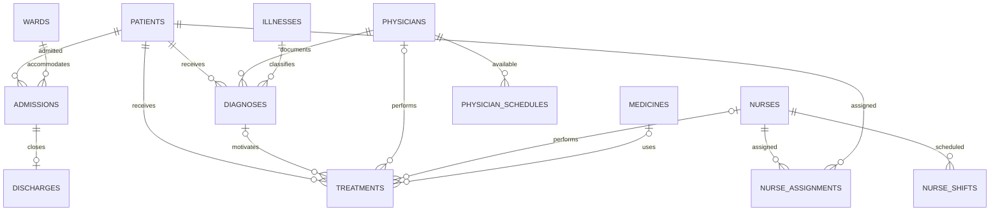

# Architecture and domain rules

Wardline is a dependency-free demonstration web application. A Node.js HTTP handler serves the static frontend and JSON routes; a repository module mediates all database access. A catalog provides the field schemas used by both HTTP validation and generated record forms.

## Components and responsibilities

| Component | Responsibility |
| --- | --- |
| `public/index.html` | Semantic app shell, navigation targets, modal dialogs, SVG symbols |
| `public/styles.css` | Responsive layout, typography, visual components, focus/reduced-motion styles |
| `public/app.js` | Routing, asynchronous UI state, CRUD interactions, table pagination, chart rendering |
| `src/server.js` | Static-file allowlist, content/security headers, body size limit, API routing, HTTP errors |
| `src/export.js` | Bounded CSV downloads with full form fields, relation labels, and formula escaping |
| `src/catalog.js` | Whitelisted resources, labels, field types, constraints, relation destinations |
| `src/repository.js` | Parameterized CRUD/search SQL, transactions, validation, cross-record rules, dashboard queries |
| `src/reports.js` | Parameterized, date-bounded operational SQL analytics with CTEs and window functions |
| `src/integrity.js` | Read-only SQL checks for seven cross-record data integrity rules, with bounded examples |
| `src/database.js` | SQLite connections, transactional migration runner, first-run seeding |
| `src/migrations.js` + `src/migrations/*.sql` | Ordered SQL schema versions and unversioned-schema compatibility checks |
| `src/seed.js` | Deterministic fictitious people, operations, and clinical example data |
| `test/` | Isolated database and in-process HTTP regression tests |

## Data model

There are 13 editable resources: patients, physicians, nurses, wards, illnesses (shown as Conditions), medicines (Pharmacy), admissions, discharges, diagnoses, treatments, nurse assignments, physician schedules, and nurse shifts.

## Business invariants

1. An active admission is an admission without an associated discharge. A patient may have at most one active admission. Historical admission intervals for one patient cannot overlap; because dates have no time component, admission and discharge dates are treated as inclusive calendar days. Creating/editing admissions or discharges, or reopening a discharged admission, preserves this rule.
2. A ward may not hold more active admissions than its capacity. Reducing ward capacity cannot strand currently admitted patients.
3. A discharge date cannot precede its admission date. A discharge stays associated with its original admission; deleting a discharge can only reopen it if there is room and the patient is not already admitted elsewhere.
4. An optional diagnosis attached to a treatment must belong to the same patient. Reassigning a diagnosis's patient is rejected when it would invalidate existing linked treatments.
5. Nurse assignment end dates must not precede their start dates. Schedule and shift end times must follow start times within a day; overnight shifts are outside the current model.
6. Foreign-key restrictions prevent deletion of records referenced elsewhere. Repository writes are wrapped in transactions, and whitelisted field names and bound values prevent SQL string injection.

These checks are application-layer rules backed by SQLite constraints. Directly modifying the database outside the application can bypass application-layer checks.

### Independent SQL integrity audit

`GET /api/reports/integrity` runs seven **read-only**, database-wide diagnostics in `src/integrity.js`, independent of the operational report's date filters. They detect overlapping admissions for the same patient, active ward occupancy above capacity, discharges dated before admissions, treatment/diagnosis patient mismatches, reversed nurse assignment dates, and invalid physician schedule or nurse shift times. These checks are intended to reveal inconsistent records inserted outside the application's usual write paths.

The overlap query partitions stays by patient, orders them chronologically, and compares the current start with the **running maximum** of all previous end dates. A running maximum is needed: comparing only with `LAG` of the immediately preceding end date can miss overlaps when an earlier stay completely contains a more recent stay. Date-only stay intervals are inclusive, so same-day discharge/re-admission also counts as an overlap.

The response includes a total violation count, per-rule counts, and at most three sample IDs/details for each rule. SQL window functions enforce the sample bound; the endpoint neither edits records nor repairs violations. This is a targeted invariant audit rather than exhaustive data validation, and a zero count does not guarantee that all possible relations are correct. `test/integrity.test.js` uses both clean databases and deliberately inconsistent raw-SQL fixtures to validate the diagnostics.

## HTTP contract

`/api/records/:resource` supports `GET` and `POST`; `/api/records/:resource/:id` supports `GET`, `PATCH`, and `DELETE`. `GET` collection queries accept `search` (max 150 characters), `page` (positive integer), and `pageSize` (1–100). Lists return `{ rows, total, page, pageSize, pages }`. Successful writes return the saved record; deletes return `{ deleted: true, id }`.

`POST` requires a complete record with all required fields. `PATCH` accepts a nonempty partial object. Both accept JSON only, with bodies limited to 16 KiB. IDs and table/column names are validated against explicit metadata. Errors return `{ error: "description" }`, with a generic message for unhandled server exceptions.

`GET /api/lookup/:resource` returns up to 100 `{ id, label }` options per request. An optional `search` query (maximum 150 characters) matches any substring of the display label without case sensitivity, or a record's exact numeric ID when written as `#123`. Relationship forms fetch matching options on demand and retain the currently selected link even when it falls outside the latest result set.

`GET /api/export/:resource?search=...` returns a UTF-8 CSV download containing all matching records and all form fields, with extra human-readable labels for relationships. The same search validation applies; exports above 5,000 rows are rejected with `422` so the local demo remains responsive. Text cells that could be evaluated as spreadsheet formulas are prefixed with an apostrophe.

The server serves only four explicitly mapped static URLs (`/`, `/styles.css`, `/app.js`, and `/favicon.svg`). CSP, frame restrictions, no-sniff, no-referrer, and no-store headers are supplied. The default binding is `127.0.0.1`; running it on a public interface or with real records is unsupported.

## Schema migrations and query plans

Wardline stores its schema version in SQLite's `PRAGMA user_version`. `src/migrations.js` registers consecutive SQL migrations, starting with `001_initial.sql` (the original 13-table schema) and `002_patient_timeline_indexes.sql`. Each version runs inside a single `BEGIN IMMEDIATE` transaction; the version number is advanced only after its SQL succeeds. On a fresh file, deterministic demo seeding runs inside that same transaction. A failure rolls back the schema, version number, and any partial seed data.

Version-zero databases with existing schema objects are treated as pre-migration installations rather than new databases. Before adopting them, the runner checks all 13 expected tables and their column layouts, then idempotently ensures the original indexes exist and applies subsequent upgrades. This preserves existing records, even if a user deliberately deleted every row. An unrelated or partially formed database is rejected. A file whose schema version exceeds the app's supported version also fails without modification. If upgrading a real local demo file, stop the server and back up the SQLite file before starting the updated app.

The second migration adds `(patient_id, admitted_on, id)` to accelerate patient admission histories (including the `LEAD` return-window analysis), plus `(patient_id, diagnosed_on)` and `(patient_id, performed_on)` for chronological diagnosis and treatment lookups. `test/database.test.js` inspects `EXPLAIN QUERY PLAN` to verify SQLite selects these indexes for bounded patient timeline queries; it avoids fragile wall-clock performance thresholds. Query planner choices and true throughput will vary with data volume and distribution; the small synthetic fixture is not a production benchmark.

To introduce a change, add the next numbered `.sql` file to `src/migrations/`, append its entry to the registry, and add regression tests for both a fresh database and upgrades from older versions. Keep released files immutable: existing installations can already have applied them. SQL migration statements must not contain their own `BEGIN`/`COMMIT` boundaries because the runner manages the transaction.

## Tradeoffs and future work

- Native SQLite keeps onboarding easy and demo startup self-contained; it currently depends on the experimental Node `node:sqlite` interface and is synchronous.
- HTML/CSS/JavaScript without framework dependencies makes the project inspectable and lightweight. A larger product could split UI components and add a dedicated integration/browser test suite.
- The UI is optimized for demonstration data and a single local process. Concurrent users, identity, permission boundaries, backups, compliance, and persistent audit logging have not been implemented.
- Dashboard admission trends are calculated in the server's UTC calendar months. Historical seed data and current date can affect the visible trend.
# Operational SQL reporting

`GET /api/reports/operations?from=YYYY-MM-DD&to=YYYY-MM-DD` calculates a report over an **inclusive** UTC calendar-date range of 1–366 days. The server validates exact ISO calendar dates and chronological order; SQL binds both dates as parameters. `src/reports.js` contains the queries and `test/reports.test.js` has deterministic relational fixtures.

- **Ward utilization:** a left join from admissions to the unique discharge row creates intervals. An interval intersects the report if the admission started on/before `to` and its discharge is absent or on/after `from`. Clipping both ends with `MAX`/`MIN` gives inclusive *occupied bed-days*. A separate `occupied` CTE aggregates before joining all wards, preserving empty wards. `DENSE_RANK` ranks occupancy normalized by each ward's capacity. Available bed-days are capacity × report days. A stay counts on both admission and discharge dates.
- **Ward capacity pressure:** a recursive calendar and a compact event stream calculate each ward's daily census. Each admission adds one bed on its first day, and each discharge subtracts one on the following day. An opening-census aggregate carries pre-existing stays into the report window; `SUM(...) OVER (PARTITION BY ward_id ORDER BY day)` then produces a date-complete series without expanding every admission into individual stay dates. `ROW_NUMBER` selects the earliest peak day deterministically. The result exposes `peak_census`, `peak_day`, `days_at_capacity` (days at or above the limit), and `days_over_capacity` (days strictly above). `census_bed_days` independently reconciles against interval-derived occupied bed-days in the tests. These comparisons use each ward's **current** capacity because the schema does not track historical capacity changes.
- **Daily flow:** a recursive calendar CTE generates every date, including days with zero events. Separate admission and discharge aggregations prevent multiplicative joins. An opening-census aggregate counts patients already admitted at the start of the period. `LAG` shifts the discharge event by one day, then a windowed `SUM` adds admissions and subtracts prior-day discharges to derive the **inclusive daily census**. This avoids joining every admission to every generated date. A second windowed `SUM` computes **within-window** cumulative net admissions minus discharges, intentionally distinct from absolute census because patients present before `from` contribute to census.
- **Physician activity:** diagnoses and treatments are grouped by physician independently and only then joined to physician records. This avoids the classic `diagnoses × treatments` fanout. `COUNT(DISTINCT patient_id)` counts unique patients with physician-performed treatments, and `RANK` provides workload ordering. Unassigned treatments are excluded from individual physician workload.
- **Length of stay:** calculated for discharges occurring within the range, using inclusive calendar days from the linked admission. It is `null` if there are no qualifying discharges.
- **Observed 30-day returns:** `LEAD(admitted_on) OVER (PARTITION BY patient_id ORDER BY admitted_on, id)` locates the next recorded stay within each patient's complete admission history. The query then joins the discharge of the preceding stay and selects discharges in the requested range; applying this range *after* the window function is essential because a return can happen after `to`. A return is counted only if the next recorded admission begins 1–30 calendar days after discharge, irrespective of destination ward. A grouped CTE yields return counts and observed shares by **discharge ward**, and a left join retains wards with no discharges (`return_pct = null`). The sum of ward denominators equals the discharge count in the existing report. This is a retrospective description of recorded data, **not** a risk-adjusted clinical readmission metric: absent future records or incomplete follow-up can undercount subsequent visits, and no reason-for-return classification is made.

Date and physician indexes are part of the first schema migration; patient timeline indexes are added in the second. Existing unversioned databases are upgraded when opened. The project uses a local, synthetic dataset and is intended for portfolio demonstration; reporting queries make no clinical or production performance claim.
