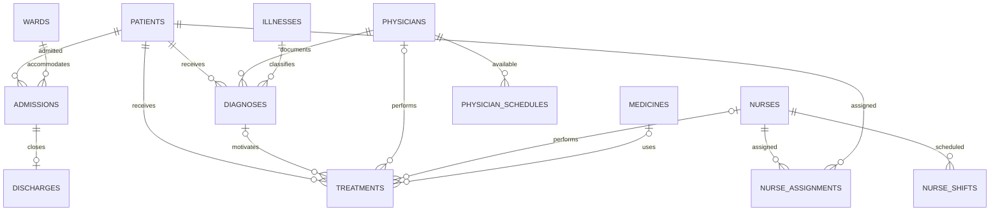

# Architecture and domain rules

Wardline is a dependency-free demonstration web application. A Node.js HTTP handler serves the static frontend and JSON routes; a repository module mediates all database access. A catalog provides the field schemas used by both HTTP validation and generated record forms.

## Components and responsibilities

| Component | Responsibility |
| --- | --- |
| `public/index.html` | Semantic app shell, navigation targets, modal dialogs, SVG symbols |
| `public/styles.css` | Responsive layout, typography, visual components, focus/reduced-motion styles |
| `public/app.js` | Routing, asynchronous UI state, CRUD interactions, table pagination, chart rendering |
| `src/server.js` | Static-file allowlist, content/security headers, body size limit, API routing, HTTP errors |
| `src/export.js` | Bounded CSV downloads with full form fields, relation labels, and formula escaping |
| `src/catalog.js` | Whitelisted resources, labels, field types, constraints, relation destinations |
| `src/repository.js` | Parameterized CRUD/search SQL, transactions, validation, cross-record rules, dashboard queries |
| `src/database.js` | SQLite schema, foreign keys, indexes, first-run initialization |
| `src/seed.js` | Deterministic fictitious people, operations, and clinical example data |
| `test/` | Isolated database and in-process HTTP regression tests |

## Data model

There are 13 editable resources: patients, physicians, nurses, wards, illnesses (shown as Conditions), medicines (Pharmacy), admissions, discharges, diagnoses, treatments, nurse assignments, physician schedules, and nurse shifts.

## Business invariants

1. An active admission is an admission without an associated discharge. A patient may have at most one active admission. Historical admission intervals for one patient cannot overlap; because dates have no time component, admission and discharge dates are treated as inclusive calendar days. Creating/editing admissions or discharges, or reopening a discharged admission, preserves this rule.
2. A ward may not hold more active admissions than its capacity. Reducing ward capacity cannot strand currently admitted patients.
3. A discharge date cannot precede its admission date. A discharge stays associated with its original admission; deleting a discharge can only reopen it if there is room and the patient is not already admitted elsewhere.
4. An optional diagnosis attached to a treatment must belong to the same patient. Reassigning a diagnosis's patient is rejected when it would invalidate existing linked treatments.
5. Nurse assignment end dates must not precede their start dates. Schedule and shift end times must follow start times within a day; overnight shifts are outside the current model.
6. Foreign-key restrictions prevent deletion of records referenced elsewhere. Repository writes are wrapped in transactions, and whitelisted field names and bound values prevent SQL string injection.

These checks are application-layer rules backed by SQLite constraints. Directly modifying the database outside the application can bypass application-layer checks.

## HTTP contract

`/api/records/:resource` supports `GET` and `POST`; `/api/records/:resource/:id` supports `GET`, `PATCH`, and `DELETE`. `GET` collection queries accept `search` (max 150 characters), `page` (positive integer), and `pageSize` (1–100). Lists return `{ rows, total, page, pageSize, pages }`. Successful writes return the saved record; deletes return `{ deleted: true, id }`.

`POST` requires a complete record with all required fields. `PATCH` accepts a nonempty partial object. Both accept JSON only, with bodies limited to 16 KiB. IDs and table/column names are validated against explicit metadata. Errors return `{ error: "description" }`, with a generic message for unhandled server exceptions.

`GET /api/lookup/:resource` returns up to 100 `{ id, label }` options per request. An optional `search` query (maximum 150 characters) matches any substring of the display label without case sensitivity, or a record's exact numeric ID when written as `#123`. Relationship forms fetch matching options on demand and retain the currently selected link even when it falls outside the latest result set.

`GET /api/export/:resource?search=...` returns a UTF-8 CSV download containing all matching records and all form fields, with extra human-readable labels for relationships. The same search validation applies; exports above 5,000 rows are rejected with `422` so the local demo remains responsive. Text cells that could be evaluated as spreadsheet formulas are prefixed with an apostrophe.

The server serves only four explicitly mapped static URLs (`/`, `/styles.css`, `/app.js`, and `/favicon.svg`). CSP, frame restrictions, no-sniff, no-referrer, and no-store headers are supplied. The default binding is `127.0.0.1`; running it on a public interface or with real records is unsupported.

## Tradeoffs and future work

- Native SQLite keeps onboarding easy and demo startup self-contained; it currently depends on the experimental Node `node:sqlite` interface and is synchronous.
- HTML/CSS/JavaScript without framework dependencies makes the project inspectable and lightweight. A larger product could split UI components and add a dedicated integration/browser test suite.
- The UI is optimized for demonstration data and a single local process. Concurrent users, migrations, identity, permission boundaries, backups, compliance, and auditing have not been implemented.
- Dashboard admission trends are calculated in the server's UTC calendar months. Historical seed data and current date can affect the visible trend.
